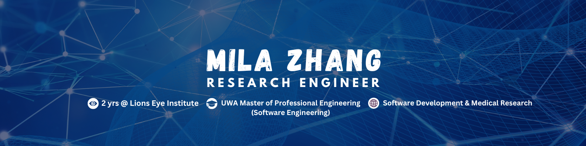

<!--
**milanaveed/milanaveed** is a ✨ _special_ ✨ repository because its `README.md` (this file) appears on your GitHub profile.

Here are some ideas to get you started:

- 🔭 I’m currently working on ...
- 🌱 I’m currently learning ...
- 👯 I’m looking to collaborate on ...
- 🤔 I’m looking for help with ...
- 💬 Ask me about ...
- 📫 How to reach me: ...
- 😄 Pronouns: ...
- ⚡ Fun fact: ...
-->

<!--
How to open preview in vscode: https://code.visualstudio.com/docs/languages/markdown#_markdown-preview
-->

<!-- 

    

        
    

 -->

# Hey, I am Mila 👋

I'm a research engineer working on eye research and am interested in STEM and medicine, including cancer and cardiology. Currently conducting a range of data analysis, software development and research tasks at Lions Eye Institute in Perth.

💬 Interested in research collaboration? Feel free to reach out via <a href="mailto:mila.zhang@uwa.edu.au">email</a>

## 💻 Tech Stack

<b>Languages</b>

 
<code></code>
<code></code>
<code></code>
<code></code>
<code></code>
<code></code>
<code></code>

<b>Frontend</b>

 
<code></code>
<code></code>
<code></code>
<code></code>
<code></code>

<b>Backend</b>

 
<!-- <code></code> -->
<!-- <code></code> -->
<code></code>
<!-- <code></code> -->
<code></code>

<!-- 

<b>Mobile</b>

 
<code></code>
<code></code>

 -->

<!-- 

<b>Cloud & DevOps</b>

 
<code></code>
<code></code>
<code></code>
<code></code>

 -->

<b>Database</b>

 
<code></code>
<code></code>
<code></code>

## 🌟 Projects

👁️ [OCTAVA](https://github.com/milanaveed/octava) Open-source tool that performs eye image processing and analysis for microvascular data. Features include binarisation, skeletonisation, segmentation, regional analysis and batch processing. Collaborated with 5 other programmers.

👁️ [COMBAT Data Harmonisation] Developing a software tool to reduce instrument- and site-effects for optical coherence tomography angiography data across sites.

🚢 [Battleship](https://github.com/milanaveed/cits3002-labs/tree/main/22756463_BEER) - Multi-threaded two-player battleship game in the Computer Networks unit.

🖥️ [High Performance Computing] - Assignment of the CITS5507 High Performance Computing. Involved using OpenMP to perform matrix multiplication in Pawsey supercomputing environments and perfomance analysis.

📊 [Sleep Diary App](https://sleeplog-74c6f.firebaseapp.com/) - Responsive Progressive Web App for a sleep clinic. Featured user management, data storage and data analytics dashboard.

☁️ [Cloud Computing] - Assignments for the CITS5503 Cloud Computing unit. Tech involved: Amazon Web Services, Linux, Docker, DynamoDB, Django.

📖 [NLP - ABSA Research](https://drive.google.com/file/d/1LDM0aTeyFniUW042YhCcsw_4O9wiMnvn/view?usp=sharing) - An Aspect-Based Sentiment Analysis research project in the Natural Language Processing unit. Deep learning using PyTorch.

🤖 [Machine Learning](https://github.com/milanaveed/cits5508/blob/main/assignment2/assig2_22756463.ipynb) - Assignment of the CITS5508 Machine Learning unit. Trained Random Forest models for breast cancer prediction and evaluated model performance.

🍄 [AI & Super Mario Bros](https://github.com/milanaveed/cits3001_project) - Implementation of unsupervised machine learning. Reinforcement learning using Stable Baselines and PyTorch.

🐜 [Active Inference & Ant Colony Simulation] - Agent-based model written in Python that explores metrics for evaluating the presence of Stigmergy.

🔐 [Secure Coding in C] - CITS3007 Secure Coding project, taking care to avoid integer overflow and bad values to `calloc`.

## 📊 GitHub Stats

  

    
  

<!--
reference: https://github.com/jaywcjlove/jaywcjlove/blob/master/README.md?plain=1
<!--
<!--
## My previous Midjourney AI creation for fun:

    

💛 May you have the courage to face and overcome life’s challenges 💛
    

    

        
        
        
        
        
        
    

-->
